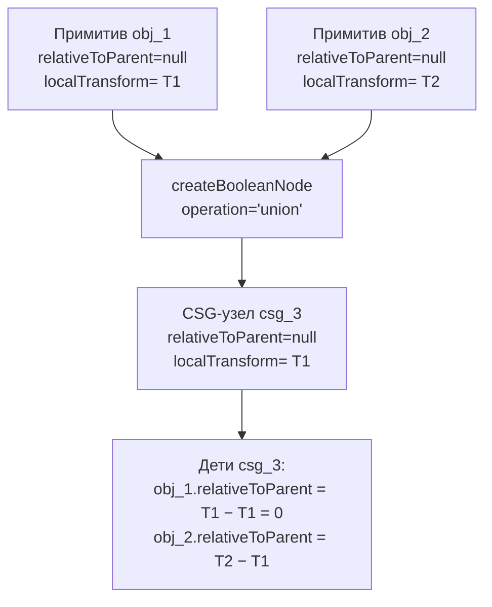
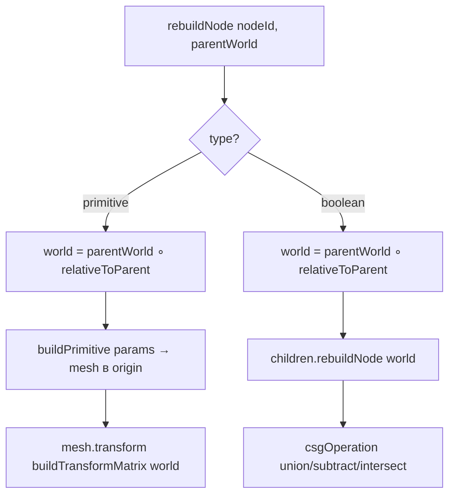
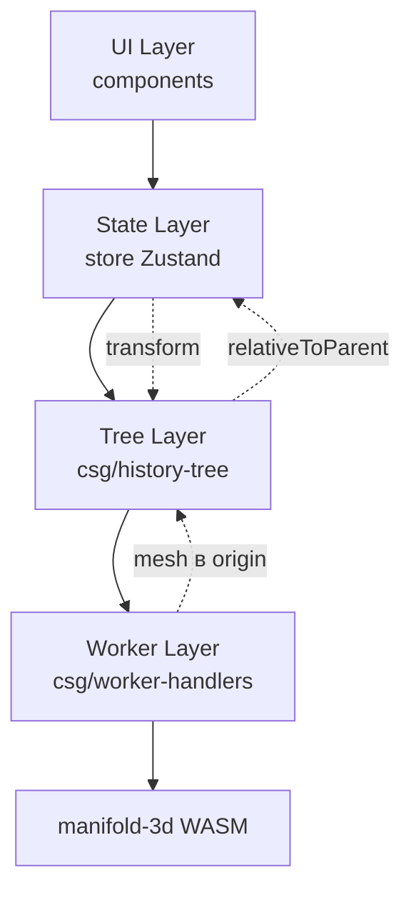

# 🏗️ ARCHITECTURE_TRANSFORMS.md

**Единая модель трансформов для TinkerCraft Web (Фаза 8)**

Версия: 1.0 · Дата: 2026-10-08 · Статус: утверждено

---

## 1. ПРИНЦИПЫ

| № | Принцип | Следствие |
|---|---------|-----------|
| 1 | **`relativeToParent` — единственный источник истины** | `localTransform` — вычисляемый, только для UI |
| 2 | **`vertices` всегда в origin (центрированы по центру масс)** | Transform применяется **один раз** при рендере/CSG |
| 3 | **Transform применяется ровно один раз** | Никаких «двойных применений» |
| 4 | **`rebuildNode` комбинирует `parentWorld ∘ relativeToParent`** | Рекурсивный обход дерева сверху вниз |
| 5 | **Все примитивы центрированы по центру масс, не по BBox** | Правильное поведение при повороте |

---

## 2. МОДЕЛЬ ДАННЫХ

### 2.1. `TreeNode` (Build Tree)

```typescript
interface TreeNode {
  id: string
  type: 'primitive' | 'boolean' | 'baked'
  shapeType?: ShapeType
  params?: ShapeParams
  operation?: 'union' | 'subtract' | 'intersect'
  children?: string[]
  parentId?: string

  // ✅ ИСТОЧНИК ИСТИНЫ
  relativeToParent: {
    positionDelta: Vec3
    rotationDelta: Vec3
    scaleRatio: Vec3
  } | null   // null для корневых нод

  // ⚠️ ВЫЧИСЛЯЕМЫЙ (только для UI)
  localTransform?: TransformNR

  // Для baked-нод (импорт STL, CSG-результаты)
  vertices?: Float32Array
  indices?: Uint32Array
  normals?: Float32Array | null

  // Кэш
  cachedMesh?: ExtractedMesh
  cachedBBox?: BoundingBox
  cacheHash?: string
}
```

**Правило:** любое изменение трансформа узла = изменение `relativeToParent`.

### 2.2. `SceneObject` (Viewport)

```typescript
interface SceneObject {
  id: string
  shapeType: ShapeType | 'csg'
  params: ShapeParams | null

  // ✅ ВСЕГДА в origin (центрированы по центру масс)
  vertices: Float32Array
  indices: Uint32Array
  normals?: Float32Array | null

  // ✅ Мировой pivot (применяется в Viewport3D)
  transform: TransformNR

  // ... (color, visible, name и т.д.)
}
```

**Правило:** `vertices` **никогда** не содержат позицию/rotation/scale. Всё — в `transform`.

---

## 3. ПОТОК ДАННЫХ

### 3.1. Создание CSG



### 3.2. Rebuild



**Ключевое:** transform применяется к **origin-мешу** ровно **один раз**.

---

## 4. ОПЕРАЦИИ

| Операция | Что меняется | `relativeToParent` | `vertices` |
|----------|--------------|-------------------|------------|
| **move** | позиция | + delta | не трогаем |
| **rotate** | вращение | + delta | не трогаем |
| **scale** | масштаб | × ratio | не трогаем |
| **resize** | params | не меняется | не трогаем |
| **mirror** | зеркало | mirror relativeToParent | не трогаем |
| **CSG** | новый узел | — | пересчитываются |
| **clone** | копия | deep copy | deep copy |
| **delete** | удаление | — | — |

**Правило:** операции меняют **`relativeToParent`**, а **не** `vertices`.

---

## 5. ЦЕНТРИРОВАНИЕ

### 5.1. Примитивы

**Все примитивы центрированы по ЦЕНТРУ МАСС в origin.**

| Примитив | Как центрируется | Центр масс |
|----------|------------------|------------|
| cube | `Manifold.cube(..., true)` | `(0,0,0)` |
| sphere | `Manifold.sphere(r, seg)` | `(0,0,0)` |
| cylinder | `Manifold.cylinder(..., true)` | `(0,0,0)` |
| cone | `Manifold.cylinder(..., true)` | `(0,0,0)` |
| torus | `Manifold.revolve(...)` | `(0,0,0)` |
| prism | `Manifold.cylinder(..., true)` | `(0,0,0)` |
| pyramid | `Manifold.cylinder(..., true)` | `(0,0,0)` |

**BBox-центр ≠ центр масс для prism/pyramid** — это нормально.

### 5.2. CSG-результаты

**CSG-результаты центрируются по ЦЕНТРУ МАСС в origin** через `centerMassAtOrigin`
(Этап 6.5; раньше — `extractAndCenterInPlace` (BBox) и `extractCenteredAt(transformA)`).

**Не по BBox!** — иначе при повороте сдвиг.

### 5.3. `centerMassAtOrigin`

**Единая функция центрирования** (с Этапа 6.5 — в `csg/geometry-utils.ts`,
`store/helpers.ts` реэкспортирует для совместимости):

```typescript
function centerMassAtOrigin(vertices: Float32Array, indices: Uint32Array): { cx, cy, cz } {
  // Замкнутая mesh — объёмный центроид (теорема дивергенции)
  // Незамкнутая — площадной центроид (взвешенный по площади)
  // Мутирует vertices in-place, возвращает смещение
}
```

**Используется:**
- Worker: `handleRebuildTreeNode` (root boolean), `handleCsgBoolean`, `handleCsgBooleanSync`
- Frontend: `document-store.csgBoolean`, `document-store.extrudeSelected`
- `store/rebuild.ts` (CSG-результаты без baked vertices)

### 5.4. Унификация центрирования (Этап 6.5)

**Проблема:** до Этапа 6.5 центрирование было рассогласовано между слоями —
три разных центра масс для одного CSG-результата:

| Слой | Формула до 6.5 | Численный тест (union куб 10 + куб 5@x=10) |
|------|----------------|---------------------------------------------|
| Worker (`handleRebuildTreeNode`, `handleCsgBooleanSync`) | vertex centroid (среднее по вершинам) | cx = 5.0 |
| Frontend (`document-store`) | `extractCenteredAt(transformA)` (pivot = позиция 1-го операнда) | cx = x(A) |
| `store/helpers.centerMassAtOrigin` | объёмный центроид (Этап 2) | cx = 10/9 ≈ 1.111 |

Разница vertex centroid vs center of mass = **3.89** для union куб+призма —
это возвращало CSG-PRISM-OFFSET / CSG-CSG-POSITION-DRIFT на Этапе 8.

**Решение:** **единая** функция `centerMassAtOrigin` (объёмный центроид,
`csg/geometry-utils.ts`) во всех слоях:
- Worker: `centerMassAtOrigin(verts, tris)` → кэш держит COM-центрированную копию
- Frontend: `centerMassAtOrigin(verts, indices)` → pivot = COM → затем сдвиг `(COM − transformA)` → pivot = transformA
- `rebuildNode`/`rebuild.ts`: `centerMassAtOrigin(verts, indices)`

Инвариант: `pivot(transformA) + vertex(pivot-centered) = world` — сходится по построению,
потому что worker и frontend вызывают одну и ту же функцию на том же мешe
(diff = 0, а не 1e-6 — это один и тот же код).

**Не использовать:** vertex centroid, BBox-center, `extractCenteredAt(transformA)`.

### 5.4b. Pivot = transformA (FIX PIVOT-TRANSFORMA, Bug 3)

Позиция pivot CSG-результата = **transformA** (позиция первого операнда), а не COM.
Gizmo CSG прикрепляется к pivot — пользователь ожидает gizmo на месте первого операнда.
`centerMassAtOrigin` по-прежнему центрирует вершины по COM (тот же центр, что и worker-кэш),
затем применяется остаточный сдвиг:

```
v_COM = v_world − COM
v_new = v_COM + (COM − transformA) = v_world − transformA
pivot = transformA
world = pivot + v_new = transformA + (v_world − transformA) = v_world  ✅
```

Для **зеркала CSG** (`mirror-store.ts`): воркер центрирует пересобранный результат по COM,
pivot = M(transformA) — вершины корректируются: `v += M(srcCom)` где
`srcCom = COM(вершины первого операнда)`. Для legacy-объектов (pivot = COM) `srcCom ≈ 0`
→ поведение не меняется.

**Известный остаток:** CENTERING-RESIDUAL (pivot legacy-документов ≠ transformA при
старом resultCenter = COM) — задокументирован, baked resultVertices путь не затронут.

### 5.4c. Фаза 8.5 — Унификация отрисовки (plan)

**Фаза 8.5** устраняет остатки: `centerGeometry` и `isPivotCenteredGeometry` удаляются полностью.
`SceneObject.vertices` всегда в origin (COM), `transform` — мировой pivot. Render = data.
См. `web-app/ARCHITECTURE_RENDER.md`.

### 5.5. Конвенция рендера/экспорта (FIX VIEWPORT-DOUBLE-CENTERING)

Вьюпорт и STL-экспорт применяют один и тот же вид трансформации:

```
world = pivot + R·S·(v − c)
```

где `c` зависит от того, **что лежит в `obj.vertices`** (`isPivotCenteredGeometry`):

| Тип объекта | `obj.vertices` | `c` | Почему |
|---|---|---|---|
| примитив | origin-геометрия **+ запечённая spawn-трансляция** (`handleBuildShape` применяет T) | `bboxCenter(v)` | вычитание снимает spawn, иначе позиция применится дважды |
| `import_mesh` | сырые координаты файла | `bboxCenter(v)` | произвольный offset импорта приводится к pivot |
| **CSG** | **pivot-центрированы (§5.4, FIX PIVOT-TRANSFORMA)**, pivot = transformA | **0** | повторное вычитание смещало бы на `bboxCenter(centered)` |

**Ловушка:** у асимметричной геометрии `COM ≠ transformA`, поэтому «универсальное»
центрирование по bbox для CSG давало сдвиг **4.2491** ед. (union куба на origin
и призмы на (10,0,0)). Проверка — `viewport-mesh-sync.test.ts`: вызывает
настоящий `useMeshSync` и сверяет world-координаты меша из scene graph с
data-world (§5.4). После фикса diff = `0.00000000`.

**Правило:** любой новый потребитель `obj.vertices` (рендер, экспорт, снап,
preview) обязан использовать `isPivotCenteredGeometry(shapeType)`, а не
вычитать bbox-центр «на всякий случай».

---

## 6. WORKER

### 6.1. Кэш

- **Кэш ВСЕГДА в origin** (без transform)
- `buildPrimitive(...)` → mesh в origin
- `handleCsgBooleanSync` → применяет transform **один раз** перед boolean

### 6.2. `handleRebuildTreeNode`

**Рекурсивный обход сверху вниз:**
1. **root boolean** — центрирует результат в origin
2. **inner boolean** — **не центрирует** (передаёт как есть)
3. **primitive** — строит в origin, применяет `localTransform`

**Ключевое:** `localTransform` **вычислен** из `relativeToParent` **до** отправки в worker.

---

## 7. РЕШАЕМЫЕ ПРОБЛЕМЫ

| Проблема | Корень | Решение |
|----------|--------|---------|
| **Сдвиг CSG с призмой** | `vertices` в мировых + transform как pivot | `vertices` в origin, transform один раз |
| **Зеркало примитивов не работает** | mirror меняет `localTransform` (абсолютный) | mirror меняет `relativeToParent` |
| **Удвоение TRS при resize** | `resizeObject` записывает mesh с transform | `resizeObject` не трогает `vertices` |
| **RENDER-PRISM-BBOX-OFFSET** | `centerGeometry` вычитал bboxCenter вместо spawn → сдвиг | Решён в 8.5.3 — `centerGeometry` удалён |
| **Потеря RS при mirror CSG** | RS в `localTransform`, mirror не трогает | RS в `relativeToParent` |
| **CSG-CSG drift** | root boolean центрирует, inner — нет | Единая модель: все центрируются в origin |

---

## 8. АРХИТЕКТУРНЫЕ СЛОИ



**Слои:**
1. **UI** — читает `SceneObject.transform` (pivot)
2. **State** — хранит `SceneObject.vertices` (origin) + `SceneObject.transform`
3. **Tree** — хранит `TreeNode.relativeToParent` (источник истины)
4. **Worker** — кэш в origin, transform один раз

---

## 9. МИГРАЦИЯ С ТЕКУЩЕЙ МОДЕЛИ

### Что было

```typescript
interface TreeNode {
  localTransform: TransformNR  // АБСОЛЮТНЫЙ
  // relativeToParent отсутствует
}
```

### Что стало

```typescript
interface TreeNode {
  relativeToParent: RelativeTransform | null  // ИСТОЧНИК ИСТИНЫ
  localTransform?: TransformNR                // вычисляемый
}
```

### Шаги миграции

1. **При создании узла** — вычислить `relativeToParent` из `localTransform` родителя
2. **При rebuild** — использовать `relativeToParent`, не `localTransform`
3. **При mirror** — зеркалить `relativeToParent`
4. **При move/rotate/scale** — менять `relativeToParent`, не `localTransform`
5. **`localTransform`** — пересчитывать **перед отправкой в UI** (для Properties Panel)

---

## 10. ПРОВЕРКА

### 10.1. Модульные тесты

- `composeTransforms(parent, relative)`
- `subtractTransform(world, parent)`
- `centerMassAtOrigin(mesh)`

### 10.2. Интеграционные тесты

| # | Сценарий | Ожидание |
|---|----------|----------|
| 1 | Куб + призма `sides=3` → CSG Union | CSG на месте |
| 2 | Призма → rotate → scale → resize | Не удваивается |
| 3 | Призма → CSG → зеркало YZ | Призма зеркальна |
| 4 | CSG → CSG Union | На месте |
| 5 | Куб (scale 0.5) + призма (rot 20,20,20) → CSG | На месте |
| 6 | Export STL | Правильные координаты |
| 7 | Undo/redo | Восстанавливается |
| 8 | Save/load `.doodle` | Восстанавливается |
| 9 | render = data для всех объектов | `render_world_vertex === data_world_vertex` (diff < 1e-6) |

### 10.3. Метрики

- **0 активных проблем** в `CODE_REVIEW.md`
- **0 ошибок** `pnpm typecheck`
- **272+ тестов** проходят
- **0 drift** при CSG (проверка по логам)

---

## 11. ПРОГРЕСС ЭТАПОВ (ЧЕК-ЛИСТ)

> Агент отмечает прогресс по мере выполнения этапов.
> Легенда: 🔲 не начато · 🔄 в работе · ✅ готово
> **Правило:** этап отмечается ✅ только после `pnpm typecheck` = 0 ошибок И `pnpm test` = все зелёные.

| Этап | Описание | Статус |
|------|----------|--------|
| 0 | Подготовка — бэкап, WIP-коммит, документ | ✅ 2026-10-08 |
| 1 | Модель данных — `RelativeTransform`, `TreeNode.relativeToParent` | ✅ |
| 2 | Утилиты — `composeTransforms`, `subtractTransform`, `centerMassAtOrigin` + тесты | ✅ |
| 3 | `createBooleanNode` — заполнить `relativeToParent` детей | ✅ |
| 4 | `mirrorNodeRecursive` — зеркалить `relativeToParent` | ✅ |
| 5 | `rebuildNode` — `worldTransform = parentWorld ∘ relativeToParent` (критический) | ✅ |
| 6 | Worker — кэш в origin, transform один раз | ✅ |
| 6.5 | Унификация центрирования (centerMassAtOrigin во всех слоях) | ✅ |
| 7 | `resizeObject` — не записывать mesh в `vertices` | ✅ 2026-10-14 |
| 8 | Проверка — 8 сценариев + тесты + документация | ✅ |
| 8.5 | Унификация отрисовки и данных ( Фаза 8.5, v1.2.0) | 🔄 |

### Детальный чек-лист

#### Этап 0 — Подготовка ✅ 2026-10-08

- [x] `git status` — рабочее дерево разобрано (WIP `AGENTS.md` закоммичен)
- [x] Ветка `backup-before-phase-8` создана (указывает на `11ac75d`)
- [x] Ветка `backup-before-phase-8` запушена на GitHub
- [x] WIP-коммит `4d96322` «состояние перед Фазой 8»
- [x] `ARCHITECTURE_TRANSFORMS.md` закоммичен `58a328d`
- [x] Базовая проверка: `pnpm typecheck` — 0 ошибок, `pnpm test` — 272/272 (18 файлов)

#### Этап 1 — Модель данных ✅

- [ ] Тип `RelativeTransform` в `csg/types.ts` (`positionDelta`, `rotationDelta`, `scaleRatio`)
- [ ] `TreeNode.relativeToParent: RelativeTransform | null` — обязательное поле
- [ ] `localTransform` помечен комментарием как вычисляемый (не удалять!)
- [ ] `relativeToParent: null` во всех фабриках: `createPrimitiveNode`, `createBooleanNode`, `createBakedNode`, `cloneRecursive`
- [ ] `relativeToParent` в `WorkerNode` / сериализации (если нужно воркеру)
- [ ] Комментарии в `SceneObject`: `vertices` — в origin, `transform` — мировой pivot
- [ ] Тестовые фикстуры, создающие `TreeNode`, обновлены
- [ ] `pnpm typecheck` — 0 ошибок, `pnpm test` — 272/272
- [ ] Логика ещё НЕ читает `relativeToParent` (только добавлено поле)

#### Этап 2 — Утилиты 🔲

- [ ] `composeTransforms(parent, relative)` в `csg/worker-matrix.ts`
- [ ] `subtractTransform(world, parent)` в `csg/worker-matrix.ts`
- [ ] Round-trip: `compose(parent, subtract(world, parent)) === world`
- [ ] `centerMassAtOrigin(vertices, indices)` в `store/helpers.ts` (центр масс по площади треугольников, НЕ BBox)
- [ ] Тесты `composeTransforms` / `subtractTransform` (worker-matrix.test.ts)
- [ ] Тесты `centerMassAtOrigin`: куб, призма sides=3, пустой массив
- [x] `pnpm typecheck` — 0, `pnpm test` — все зелёные

#### Этап 3 — `createBooleanNode` ✅

- [x] При создании boolean-узла вычислять `relativeToParent` детей (`subtractTransform(childWorld, parentWorld)`)
- [x] `relativeToParent = null` для корневого boolean-узла
- [x] `localTransform` остаётся заполненным (обратная совместимость до Этапа 8)
- [x] Тест: `relativeToParent` ребёнка = `childWorld − parentWorld`
- [x] `pnpm typecheck` — 0, `pnpm test` — все зелёные

#### Этап 4 — `mirrorNodeRecursive` ✅

- [x] `subtractTransform(mirroredWorld, mirroredParentWorld)` для `relativeToParent`
- [x] `localTransform` = точное зеркало мира (`mirrorPoint` + `mirrorEuler` + `abs(scale)`)
- [x] `localTransform` = `composeTransforms(mirroredParentWorld, mirroredRelative)` ±1e-6 (round-trip тест)
- [x] Scale → `Math.abs()` (scale всегда положительный)
- [x] Rotation — простой sign flip (perpendicular unchanged, in-plane negated)
- [x] Рекурсия: дети зеркалятся с `mirroredParentWorld`
- [x] Тест: mirror примитива → `relativeToParent` зеркалится
- [x] Тест: mirror CSG → `relativeToParent` детей зеркалится
- [x] Тест: двойное зеркало → identity (±1e-6)
- [x] Тест: round-trip `composeTransforms(parentWorld, mirroredRelative) = mirroredLocal`
- [x] Тест: CSG с зеркальными детьми сохраняет RS (MIRROR-CSG-CHILD-RS-LOSS)
- [x] Тест: multi-axis rotation (Euler XYZ)
- [x] `pnpm typecheck` — 0, `pnpm test` — все зелёные

#### Этап 5 — `rebuildNode` (критический) ✅

- [x] `worldTransform = composeTransforms(parentWorld, node.relativeToParent)` при `relativeToParent !== null`
- [x] Fallback на `localTransform` при `relativeToParent === null` (обратная совместимость)
- [x] Transform применяется к origin-мешу ровно один раз
- [x] `collectSubtreeForWorker` передаёт `localTransform` (UI-контракт с воркером не сломан)
- [x] Тест: primitive с `relativeToParent` → правильная позиция
- [x] Тест: CSG из двух примитивов → на месте
- [x] Тест: rebuild после mirror → без сдвига
- [x] Тест: round-trip `composeTransforms(parentWorld, relativeToParent) = localTransform`
- [x] Тест: fallback на `localTransform` если `relativeToParent === null`
- [x] Тест: вложенный CSG (CSG из CSG)
- [x] `pnpm typecheck` — 0, `pnpm test` — все зелёные

#### Этап 6 — Worker ✅

- [x] `handleRebuildTreeNode`: root boolean центрирует, inner boolean — нет (единая логика)
- [x] `handleCsgBooleanSync`: transform применяется один раз перед boolean, результат центрируется
- [x] `handleSyncMesh`: кэш в origin (без transform)
- [x] `pnpm typecheck` — 0, `pnpm test` — все зелёные

#### Этап 6.5 — Унификация центрирования ✅

- [x] `centerMassAtOrigin` + `isClosedMesh` перенесены в `csg/geometry-utils.ts` (worker-совместимый слой), `store/helpers.ts` реэкспортирует
- [x] Worker `handleRebuildTreeNode` (root boolean): vertex centroid → `centerMassAtOrigin`
- [x] Worker `handleCsgBooleanSync`: vertex centroid → `centerMassAtOrigin`; lifetime-фиксы (кэш владеет объектом, `disposeCached` вместо `delete()` кэш-записи); response = WORLD mesh, кэш = COM-центрированная копия
- [x] Worker `handleCsgBoolean` (регрессия Этапа 6): применяет `transformA/transformB` ОДИН РАЗ к origin-кэшу; кэш = COM-копия, response = world
- [x] Frontend `document-store.csgBoolean`: `extractCenteredAt(transformA)` → `centerMassAtOrigin`, pivot = COM, `resultCenter` = COM
- [x] Frontend `document-store.extrudeSelected`: → `workerCsgBooleanWithSync` (origin-конвенция) + COM-центрирование
- [x] `store/rebuild.ts`: CSG-результаты без baked vertices → `centerMassAtOrigin` + запись центрированной копии обратно (фикс двойного смещения legacy-документов)
- [x] 6 тестов `csg/geometry-utils.test.ts` (COM union = 10/9, diff 3.89, инвариант no-offset < 1e-6, fallback, пустой mesh, паритет слоёв)
- [x] `pnpm typecheck` — 0, `pnpm test` — 323/323

**Остаточный долг (зафиксирован в DEVELOPMENT_PLAN.md):** `handleRebuildScene`
внутренне использует world-кэш (самосогласован); pivot legacy-документов
(центрирование по transformA) не мигрирован; extrude/CSG филlet-примитивов
теряет fillet при rebuild из params (buildPrimitive).

#### Этап 7 — `resizeObject` ✅ (2026-10-14)

- [x] Не записывать пересчитанный mesh с transform в `SceneObject.vertices` (примитивы — `workerBuildShape` с нулевым transform, mesh в origin; CSG — `vertices` не трогаются вовсе)
- [x] Resize примитива — только `params` (+ `localTransform` позиции по anchor; anchor в API `resizeObject` отсутствует — grep: только `alignSelected` — семантика центрального anchor, `transform.position` не меняется)
- [x] Ветвление исправлено: `shapeType !== 'csg'` — раньше CSG попадали в примитивную ветку (`params: {}` truthy); scale-ветка CSG сохраняет scale по непереданным осям
- [x] Тест: призма → rotate → scale → resize → vertices не удваиваются (+5 тестов: anchor, CSG-результат, relativeToParent, localTransform, Scenario 2 §10.2 — `store/document-store.test.ts`, mock worker-client)
- [x] `pnpm typecheck` — 0, `pnpm test` — все зелёные (329/329)

#### Этап 8 — Проверка ✅ 2026-10-14

- [x] Сценарий 1: куб + призма sides=3 → CSG Union → на месте (diff pivot/COM = 0.00)
- [x] Сценарий 2: призма → rotate → scale → resize → не удваивается (z world = 80, diff = 0)
- [x] Сценарий 3: призма → CSG → зеркало YZ → pivot зеркалён (−6.03 vs +0.06), RS детей (scale 1.5, rotZ −20) сохранён, COM doctrine diff = 9.54e-7
- [x] Сценарий 4: CSG → CSG Union → на месте (bbox diff = 9.54e-7, pivot-vs-COM diff = 9.78e-7)
- [x] Сценарий 5: куб (scale 0.5) + призма (rot 20,20,20) → CSG → на месте (bbox diff = 9.54e-7)
- [x] Сценарий 6: Export STL → STL vertex count = 186, tris = 62, bbox diff = 0.00
- [x] Сценарий 7: Undo/redo → snapshot-path diff = 0.00, rebuild-path diff = 0.00
- [x] Сценарий 8: Save/load `.doodle` → CSG восстановлен, diff = 0.00
- [x] `CHANGELOG.md` — запись про Фазу 8 Этап 8
- [x] `CODE_REVIEW.md` — закрыты CSG-PRISM-OFFSET / MIRROR-CSG-CHILD-RS-LOSS / CSG-CSG-POSITION-DRIFT
- [x] `pnpm typecheck` — 0, `pnpm test` — 337/337

**Известное ограничение:** МIRROR-CSG-PRIMITIVE-CHIRALITY — зеркало CSG, содержащего асимметричный примитив (призма sides=3), не является точным геометрическим зеркалом: `mirrorNodeRecursive` зеркалит трансформы детей, но не внутреннюю хиральность примитива (доктрина MIRROR-SCALE abs scale). Для симметричных примитивов (куб, сфера, цилиндр) зеркало точное. Для асимметричных — геометрия приближённая (зеркальный TRS без зеркального вращения хиральности), позиционирование корректно (pivot = mirrorPoint(COM), COM doctrine diff = 9.54e-7).

#### Этап 9 — Релиз ✅ 2026-10-15

- [x] Версия `1.0.0` → `1.1.0` в `web-app/package.json`
- [x] CHANGELOG.md — секция `[1.1.0]` с датой 2026-10-15
- [x] DEVELOPMENT_PLAN.md — Фаза 8 ✅
- [x] AGENTS.md — Фаза 8 ✅
- [x] Тег `v1.1.0`, push
- [x] GitHub Pages (CI соберёт)

#### Этап 8.5 — Унификация отрисовки и данных (Фаза 8.5, v1.2.0) 🔄

Полная унификация: `vertices` всегда в origin (COM), `transform` — мировой pivot, render = data.

| Подэтап | Что | Статус |
|---------|-----|--------|
| 8.5.0 | Подготовка + ARCHITECTURE_RENDER.md | ✅ 2026-10-20 |
| 8.5.1 | Worker возвращает origin для всех primitive | 🔲 |
| 8.5.2 | Store применяет spawn к transform, не к vertices | 🔲 |
| 8.5.3 | Удалить `centerGeometry` и `isPivotCenteredGeometry` | 🔲 |
| 8.5.4 | Миграция `.doodle` → `.3dtc` | 🔲 |
| 8.5.5 | CI-тест `render-data-invariant.test.ts` | 🔲 |


---

## 12. ИСТОРИЯ ИЗМЕНЕНИЙ

| Дата | Версия | Изменения |
|------|--------|-----------|
| 2026-10-08 | 1.0 | Первая версия, план Фазы 8 |
| 2026-10-08 | 1.1 | Добавлен чек-лист прогресса этапов (§11); Этап 0 выполнен |

---

## 💎 ИТОГ ОДНОЙ СТРОКОЙ

**`relativeToParent` — источник истины · `vertices` — в origin · transform — один раз · центр масс — не BBox.**

